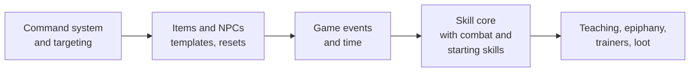

# Riftward design

Riftward is a classless telnet MUD built on a headless Bevy server. Characters are defined by the skills they learn and use, and by attributes they raise with Karma. The world is built from zone files, mostly from inside the game.

Each document below covers one area and can be read on its own. This page is the summary and the index.

## Design goals

- **Builds emerge from play.** There are no classes. Combining skill trees (sword and fire, stealth and herbalism) is how players invent their own archetypes.
- **Learning is social.** Every skill can be taught, and the rarest only by players who have mastered them, so experienced players are worth seeking out.
- **Regular practice beats bingeing.** Skills improve through use, gain chances fade with time away, and cooldowns make spamming and botting pointless.
- **The world keeps secrets.** Hidden skills and magical Awakening unlock by epiphany when a character meets conditions nobody has written down.

## Documents

| Document | Covers | Status |
| --- | --- | --- |
| [Architecture](architecture.md) | How the server is built today, and the foundation still needed: commands, items and NPCs, events, time, combat | Partly built; foundation proposed |
| [Skills](skills.md) | Skill trees, active and passive skills, rarity, how skills are acquired, hidden skills | Designed |
| [Progression](progression.md) | How skills level through use: practice, gain chance, gain cooldowns | Designed |
| [Attributes, Karma and Luck](attributes.md) | The ten attributes, Karma, the ratio rule, Luck and the `Dice` service | Built (Karma earning waits on skills) |
| [Magic and Awakening](magic.md) | Magic, the four traditions, and how characters Awaken | Designed |
| [Items, containers and locks](items.md) | Templates, Bulk, hands and wear slots, containers and automatic placement, encumbrance, persistence, decay, unique items, locks and keys, traps | Mostly built |
| [The living world](world.md) | Spawns and resets, breeding, wandering and crowding, doors and hidden doors, world flags and events | Designed |
| [Riftwatch](riftwatch.md) | The starting town: map, districts, doors, where trainers go, the sewers | Rooms and doors built |
| [Races, backgrounds and creation](characters.md) | Character creation, the eight races and their skills, backgrounds, Awakened backgrounds | Outlined |

## What exists today

- Telnet server, one command handled per player per tick, in the order typed.
- Accounts and characters in SQLite, with roles: player, builder, admin.
- Zone files in `assets/zones`, hot-reloaded, plus in-game building: `dig`, `desc`, `link`, `zone create`, and more.
- Communication: `say`, `whisper`, `yell` (zone), `gossip` (global).
- Riftwatch, the starting town, and the sewers beneath it ([map](riftwatch.md#map)).
- Items: templates with Bulk and tags, hands, wear slots, containers (backpacks, pouches, keyrings, pockets, chests) with automatic placement, encumbrance, keys, and real items that survive restarts.
- Doors and trapdoors: `open`, `close`, `lock`, `unlock`, `bash`, by direction or name, and the builder `door` command.
- A command registry with generated `help`, permission-hidden commands, and target resolution (`2.goblin`, `all.coin`, `me`).
- Per-character aliases.
- Attributes, starting Karma, `raise`, `score`, and the Luck-aware `Dice` service.

## Roadmap

The engine foundation comes before the skill system, because skills need things to act on: targets, items, events and time. See [Architecture](architecture.md#proposed-build-order) for detail.

## Planned features

Designed, waiting on other work:

| Feature | Waits on | Details |
| --- | --- | --- |
| Status prompt (`<14/18hp 9/10fat>`), customisable per character | Current health and fatigue, from combat and time | [Architecture](architecture.md#status-prompt) |
| Unique items that never respawn once found, like *Angorim*, and never decay | Items and resets | [Architecture](items.md#unique-items) |
| Scripting for behaviour data can't express; language to decide (Steel, Rhai or Lua) | The effect system, NPCs and game events | [Architecture](architecture.md#scripting) |

## Decisions so far

| Area | Decision |
| --- | --- |
| Classes | None. Skill trees, with hybrid skills across trees |
| Learning | Every skill can be taught. Students need the skill's requirements, not its tree. Loot-only skills are taught only by masters |
| Progression | Use-based gains; practice builds with use and fades with time; a level-scaled cooldown per gain |
| Skill kinds | Active (invoked with `use <skill> <target>`) and passive (progress on trigger events, usually outcomes) |
| Combat | Made entirely of skills. Everyone starts with a basic attack skill; NPCs fight with skills too. Built with the skill core |
| Starting skills | Granted by race and background, plus universal skills. Racial abilities are skills that require the race. Backgrounds can require attributes or a race |
| Races | The eight Earthdawn races: Dwarf, Elf, Human, Obsidiman, Ork, Troll, T'skrang, Windling |
| Hidden skills | Learned by epiphany when conditions are met, with an optional trigger |
| Attributes | Ten, uncapped, Shadowrun and Earthdawn flavoured. Start at 1 (Magic 0) with 10 Karma to spend, which can go on Magic as latent talent |
| Formulas | Contests compare ratios, never differences, because attributes are uncapped |
| Luck | Every roll has a Luck-based chance to be rolled twice, keeping the better. Group loot uses the group's average Luck |
| Magic | Latent until the character knows a casting skill; knowing one is being Awakened. Four traditions; masters can teach casting skills; Awakened backgrounds grant one but require Magic 1, bought with starting Karma |
| Commands | Players can define aliases; aliases can't shadow built-in commands |
| Persistence | An item becomes real (saved) the moment a player touches it, and then survives restarts wherever it is. Untouched spawns and NPCs reset |
| Spawns | One model: each spawn resets on its own timer (`every`, or `AfterDeath` for bosses) and either keeps a count or breeds, reseeding a week after being wiped out. NPCs count toward their spawn wherever they wander |
| World events | Data-driven triggers and actions over world flags, counters, spawn counts and game events |
| Item decay | Dropped items decay (litter); perishables rot even when carried; unique items never decay |
| Locks | Doors and containers share one lock: open, closed or locked, with keys, `pick` and `bash` (which only forces it open). Locks reset with their zone; hidden doors are found per character |

## Biggest open questions

Each document lists its own open questions. These are the ones that shape the most:

1. **What stops one character learning every tree?** A total cap on skill levels, skill slots, or rising costs. See [Skills](skills.md#open-questions).
2. **Which backgrounds, do races adjust attributes,** and are Awakened backgrounds balanced? See [Races and backgrounds](characters.md#open-questions).
3. **Auto-attack or explicit attacks in combat?** See [Skills](skills.md#open-questions).
