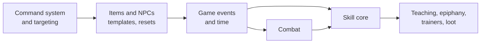

# MUD design

A classless telnet MUD built on a headless Bevy server. Characters are defined by the skills they learn and use, and by attributes they raise with Karma. The world is built from zone files, mostly from inside the game.

Each document below covers one area and can be read on its own. This page is the summary and the index.

## Design goals

- **Builds emerge from play.** There are no classes. Combining skill trees (sword and fire, stealth and herbalism) is how players invent their own archetypes.
- **Learning is social.** Every skill can be taught, and the rarest only by players who have mastered them, so experienced players are worth seeking out.
- **Regular practice beats bingeing.** Skills improve through use, gain chances fade with time away, and cooldowns make spamming and botting pointless.
- **The world keeps secrets.** Hidden skills and magical Awakening unlock by epiphany when a character meets conditions nobody has written down.

## Documents

| Document | Covers | Status |
| --- | --- | --- |
| [Architecture](architecture.md) | How the server is built today, and the foundation still needed: commands, items and NPCs, events, time, combat | Partly built; foundation proposed |
| [Skills](skills.md) | Skill trees, active and passive skills, rarity, how skills are acquired, hidden skills | Designed |
| [Progression](progression.md) | How skills level through use: practice, gain chance, gain cooldowns | Designed |
| [Attributes, Karma and Luck](attributes.md) | The ten attributes, Karma, the ratio rule, Luck and the `Dice` service | Built (Karma earning waits on skills) |
| [Magic and Awakening](magic.md) | Magic, the four traditions, and how characters Awaken | Designed |

## What exists today

- Telnet server, one command handled per player per tick, in the order typed.
- Accounts and characters in SQLite, with roles: player, builder, admin.
- Zone files in `assets/zones`, hot-reloaded, plus in-game building: `dig`, `desc`, `link`, `zone create`, and more.
- Communication: `say`, `whisper`, `yell` (zone), `gossip` (global).
- Per-character aliases.
- Attributes, starting Karma, `raise`, `score`, and the Luck-aware `Dice` service.

## Roadmap

The engine foundation comes before the skill system, because skills need things to act on: targets, items, events and time. See [Architecture](architecture.md#proposed-build-order) for detail.

## Decisions so far

| Area | Decision |
| --- | --- |
| Classes | None. Skill trees, with hybrid skills across trees |
| Learning | Every skill can be taught. Students need the skill's requirements, not its tree. Loot-only skills are taught only by masters |
| Progression | Use-based gains; practice builds with use and fades with time; a level-scaled cooldown per gain |
| Skill kinds | Active (invoked with `use <skill> <target>`) and passive (progress on trigger events, usually outcomes) |
| Hidden skills | Learned by epiphany when conditions are met, with an optional trigger |
| Attributes | Ten, uncapped, Shadowrun and Earthdawn flavoured. Start at 1 (Magic 0) with 10 Karma to spend |
| Formulas | Contests compare ratios, never differences, because attributes are uncapped |
| Luck | Every roll has a Luck-based chance to be rolled twice, keeping the better. Group loot uses the group's average Luck |
| Magic | Requires Awakening. Four traditions; masters can Awaken apprentices |
| Commands | Players can define aliases; aliases can't shadow built-in commands |

## Biggest open questions

Each document lists its own open questions. These are the ones that shape the most:

1. **What stops one character learning every tree?** A total cap on skill levels, skill slots, or rising costs. See [Skills](skills.md#open-questions).
2. **What survives a server restart?** Only what players carry, or the whole world. See [Architecture](architecture.md#open-questions).
3. **Does combat come before the skill core,** or after it? See [Architecture](architecture.md#open-questions).
