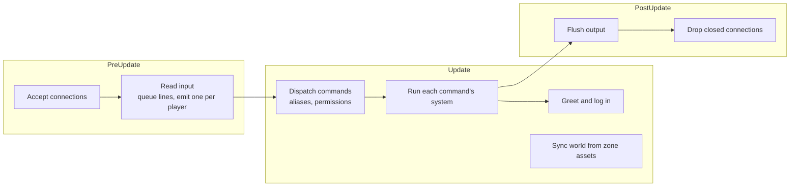

# Architecture

[Design summary](README.md) · Status: the server below is built; the [foundation](#foundation-still-needed) is proposed

The server is a headless Bevy app: no window or renderer, just the ECS, the app loop, logging and asset loading. Players connect over telnet. Designed content (the world, later skills) lives in hot-reloaded RON files; anything that changes during play lives in SQLite.

## The server today

### Running it

```sh
cargo run                       # listens on 0.0.0.0:4000, database mud.db
MUD_ADDR=127.0.0.1:5000 cargo run
MUD_DB=/tmp/test.db cargo run
nc localhost 4000               # or telnet, TinTin++, Mudlet
```

`cargo run` matters: it is how Bevy finds the project's `assets/` folder.

### Modules

| Module | Responsibility |
| --- | --- |
| `main.rs` | Builds the app: a 30 Hz loop, logging, asset loading with file watching, and the plugins below |
| `net.rs` | TCP listener; one entity per connection with a `Connection` component; queues each client's lines and hands out one per tick as a `PlayerInput` message; flushes output at the end of the frame |
| `login.rs` | Login state machine: account, password (hidden with telnet echo control), new accounts, character choice and creation |
| `command.rs` | The command system: `CommandSpec` registry, the dispatcher (alias expansion, permission hiding, unknown commands), generated `help`, and prompts |
| `commands/` | Player commands, one system each: `movement` (look, go, directions), `communication` (say, whisper, yell, gossip, who), `character` (score, raise, alias, unalias, quit) |
| `build.rs` | Builder and admin commands, registered with a permission |
| `targeting.rs` | `Keywords` and `Target`: resolving `goblin`, `2.goblin`, `all.coin`, `me` |
| `output.rs` | Shared output plumbing: `Outgoing`, `deliver`, `Actor`, the common queries, target candidate lists |
| `world.rs` | Zone assets, room entities, the `RoomIndex`, and `sync_world`, which applies zone changes live |
| `db.rs` | SQLite: accounts, characters, roles, aliases, attributes |
| `aliases.rs` | Per-character aliases |
| `attributes.rs` | Attributes, Karma costs, `score` and `raise` |
| `dice.rs` | The `Dice` resource, the only source of randomness |

### One tick



- **One line per player per tick** keeps each player's commands in the order typed, even when different systems handle them, and limits anyone to 30 commands a second.
- **Output is queued** on each `Connection` during the frame and written once at the end.
- **The connection owns the prompt.** In game, each batch of output ends with exactly one `> `, text arriving while the prompt is showing starts on a fresh line, and an empty Enter gets a new prompt. Commands and notifications never write prompts themselves.

### Data

| Kind | Where | Reloads |
| --- | --- | --- |
| World | `assets/zones/<zone>.ron`, one file per zone; builder commands write back to them | Live, on file change |
| Accounts, characters, roles | `accounts`, `characters` tables | n/a |
| Aliases | `character_aliases` table | n/a |
| Attributes | `character_attributes` table | n/a |

Tables are created with `CREATE TABLE IF NOT EXISTS`. The next change to an existing table needs numbered migrations (`PRAGMA user_version`).

## Foundation still needed

The skill design depends on things the server doesn't have: targets, items, events and time. These pieces come first.

### Command system and targeting (built)

Each command is registered with a `CommandSpec` (name, short forms, category, permission, usage, summary) and its own Bevy system, which receives an `Invocation` and asks for exactly the resources it needs:

```rust
app.add_command(
    CommandSpec::new("whisper", Category::Communication)
        .usage("whisper <player> <text>")
        .summary("speak privately to someone in the room"),
    communication::whisper,
);
```

- **One dispatcher** expands aliases, hides commands a player lacks permission for (they get the same "Huh?" as a typo), and queues the command's system. The prompt is sent after the command's output, so handlers never send it.
- **`help`** is generated from the registry, grouped by category and filtered by role; `help <command>` shows usage.
- **Targets** are resolved by `Target::parse` and `find_one` / `find_all` over candidates with `Keywords`: a word matches the start of any keyword, `2.x` picks the second match, `all.x` every match, and `me` the player. Others are preferred; the player is the fallback when only they match. Today the candidates are players; items and NPCs join when they exist.

### Things in the world

Items and NPCs become entities. One location component replaces `InRoom`: in a room, carried by someone, inside a container, or worn. Starting point: `get`, `drop`, `put`, `inventory`, `look <thing>`.

### Templates and resets

Zone files gain NPC and item templates and say where they appear. Each zone repopulates on a timer, the classic Diku-style reset, so builders don't place everything by hand. Builder commands edit templates and spawn points.

**What survives a restart (decided, for now):** only what players carry is saved. Items on the ground, corpses and NPCs reset when the server restarts, and zone resets repopulate the world. Saved world items and unique items are [planned](#planned-features).

### Game events

One vocabulary of game events (`Attacked`, `DodgeSucceeded`, `ManaSpent`, `DamageTaken`, `EnteredRoom`, `ItemPickedUp`, ...) published as Bevy messages by every system. Passive-skill triggers, hidden-skill triggers and easter-egg flags all listen to the same events, so new content adds events, not special cases.

### Time

A game clock with day and night, a regular tick for regeneration, and actions that take time to complete (lessons, rituals, casting). Practice fade and cooldowns already use stored timestamps, so they need no timer of their own.

### Combat

The round loop, initiative, damage, death and respawn: infrastructure with no actions of its own. Every action in combat is a skill, starting with the basic attack every character has (see [Skill kinds](skills.md#skill-kinds)), so combat is built together with the skill core. Every roll goes through `Dice`, and every contest follows the [ratio rule](attributes.md#the-ratio-rule).

## Planned features

Features that are designed but wait on other work.

### Saved world items

Items left in the world (dropped on the ground, placed in a container in a room) survive a restart, instead of only what players carry. This makes the world persistent: a sword left in the tavern is still there tomorrow.

### Unique items

Some items exist only once and never respawn: once *Angorim* has been found, the zone's reset never creates another.

- **Templates are marked unique** (`unique: true`); a zone reset checks before spawning one.
- **Their state is saved even under "only carried items persist",** in a small `unique_items` table, so a restart never spawns a second copy.
- **Lifecycle, to decide:** waiting to be found, held by a character, lying somewhere, or destroyed. What happens when its holder's character is deleted, or it's left on the ground at a restart, decides whether it can ever return to the world.

### Status prompt

The in-game prompt shows the character's state, such as `<14/18hp 9/10fat>`, instead of a bare `> `.

- **Always current.** The connection writes the prompt once at the end of each tick (see [One tick](#one-tick)), so it is built fresh from the character's state every time, including damage taken between the player's own commands.
- **Built by the game, shown by the connection.** A system just before output is flushed computes each player's prompt text and hands it to their `Connection`. `net.rs` only knows how to show "the current prompt", never game rules.
- **Customisable per character,** saved like aliases, with placeholder codes and a default for new characters:

  ```
  prompt <%h/%Hhp %f/%Ffat>      ->   <14/18hp 9/10fat>
  prompt                          ->   back to the default
  ```

- **Recognisable by MUD clients.** Marking the prompt with telnet IAC GA lets clients like Mudlet and TinTin++ draw gauges or pin the prompt. Raw `nc` would show stray characters, so it is sent only to clients that ask for it.
- **Waits on current health and fatigue.** Only the maximums exist today (from Body and Willpower); current values arrive with combat and the time system (damage and regeneration).

## Proposed build order

1. ~~**Command system and targeting.**~~ Built.
2. **Things in the world, templates and resets.** Items first, then NPCs that stand in rooms and can be looked at.
3. **Game events and time.** Both small, but everything after this uses them.
4. **The [skill core](skills.md#build-plan), with combat as its first use.** The round loop is built alongside it, and the basic attack is the first skill. Starting skills from [race and background](characters.md) arrive here too.

Then teaching, epiphany, trainers and loot follow: trainers are NPCs, loot scrolls are items, and passive skills have events to trigger on.

## Open questions

- [ ] **Unique item lifecycle:** if a unique item's holder deletes their character, or it is left on the ground at a restart, does it return to its spawn point, or is it gone for good?
