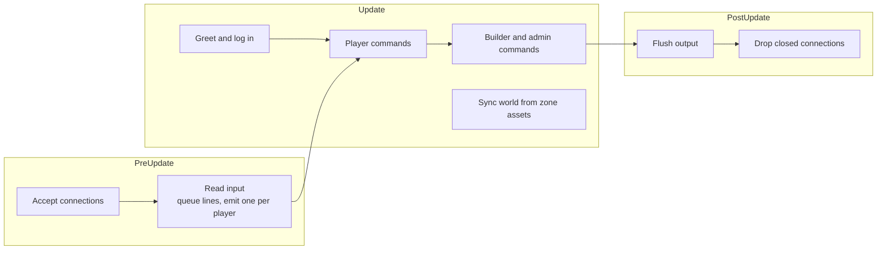

# Architecture

[Design summary](README.md) · Status: the server below is built; the [foundation](#foundation-still-needed) is proposed

The server is a headless Bevy app: no window or renderer, just the ECS, the app loop, logging and asset loading. Players connect over telnet. Designed content (the world, later skills) lives in hot-reloaded RON files; anything that changes during play lives in SQLite.

## The server today

### Running it

```sh
cargo run                       # listens on 0.0.0.0:4000, database mud.db
MUD_ADDR=127.0.0.1:5000 cargo run
MUD_DB=/tmp/test.db cargo run
nc localhost 4000               # or telnet, TinTin++, Mudlet
```

`cargo run` matters: it is how Bevy finds the project's `assets/` folder.

### Modules

| Module | Responsibility |
| --- | --- |
| `main.rs` | Builds the app: a 30 Hz loop, logging, asset loading with file watching, and the plugins below |
| `net.rs` | TCP listener; one entity per connection with a `Connection` component; queues each client's lines and hands out one per tick as a `PlayerInput` message; flushes output at the end of the frame |
| `login.rs` | Login state machine: account, password (hidden with telnet echo control), new accounts, character choice and creation |
| `commands.rs` | Player commands, alias expansion, permission checks, and the shared output plumbing (`Outgoing`, `deliver`) |
| `build.rs` | Builder and admin commands, received as `BuildCommand` messages after the permission check |
| `world.rs` | Zone assets, room entities, the `RoomIndex`, and `sync_world`, which applies zone changes live |
| `db.rs` | SQLite: accounts, characters, roles, aliases, attributes |
| `aliases.rs` | Per-character aliases |
| `attributes.rs` | Attributes, Karma costs, `score` and `raise` |
| `dice.rs` | The `Dice` resource, the only source of randomness |

### One tick



- **One line per player per tick** keeps each player's commands in the order typed, even when different systems handle them, and limits anyone to 30 commands a second.
- **Output is queued** on each `Connection` during the frame and written once at the end.

### Data

| Kind | Where | Reloads |
| --- | --- | --- |
| World | `assets/zones/<zone>.ron`, one file per zone; builder commands write back to them | Live, on file change |
| Accounts, characters, roles | `accounts`, `characters` tables | n/a |
| Aliases | `character_aliases` table | n/a |
| Attributes | `character_attributes` table | n/a |

Tables are created with `CREATE TABLE IF NOT EXISTS`. The next change to an existing table needs numbered migrations (`PRAGMA user_version`).

## Foundation still needed

The skill design depends on things the server doesn't have: targets, items, events and time. These pieces come first.

### Command system and targeting

Replace the large `match` in `commands.rs` with a registry where each command declares its name, permission, help text and arguments. `help`, alias checks and permission checks then all read from one place. Target resolution handles `goblin`, `2.goblin` and `all.coin`, in the room, in inventory, or in a container. Skills need it for `use <skill> <target>` and teaching needs it for `teach <player> <skill>`.

### Things in the world

Items and NPCs become entities. One location component replaces `InRoom`: in a room, carried by someone, inside a container, or worn. Starting point: `get`, `drop`, `put`, `inventory`, `look <thing>`.

### Templates and resets

Zone files gain NPC and item templates and say where they appear. Each zone repopulates on a timer, the classic Diku-style reset, so builders don't place everything by hand. Builder commands edit templates and spawn points.

### Game events

One vocabulary of game events (`Attacked`, `DodgeSucceeded`, `ManaSpent`, `DamageTaken`, `EnteredRoom`, `ItemPickedUp`, ...) published as Bevy messages by every system. Passive-skill triggers, hidden-skill triggers and easter-egg flags all listen to the same events, so new content adds events, not special cases.

### Time

A game clock with day and night, a regular tick for regeneration, and actions that take time to complete (lessons, rituals, casting). Practice fade and cooldowns already use stored timestamps, so they need no timer of their own.

### Combat

Rounds, initiative, attacks, damage, death and respawn. Every roll goes through `Dice`, and every contest follows the [ratio rule](attributes.md#the-ratio-rule).

## Proposed build order

1. **Command system and targeting.** Everything after this adds commands, so it saves rewriting each one later.
2. **Things in the world, templates and resets.** Items first, then NPCs that stand in rooms and can be looked at.
3. **Game events and time.** Both small, but everything after this uses them.
4. **Combat.** A basic version using attributes and `Dice`.

After that the [skill core](skills.md#build-plan) has everything it needs: foraging produces items, Dodge has attacks to dodge, trainers are NPCs, and loot scrolls are items.

## Open questions

- [ ] **Does combat come before the skill core,** or does the skill core go between steps 3 and 4?
- [ ] **What survives a restart?** Proposed: only what players carry is saved; items on the ground, corpses and NPCs reset when the server restarts. Saving everything makes a persistent world but is much more work.
