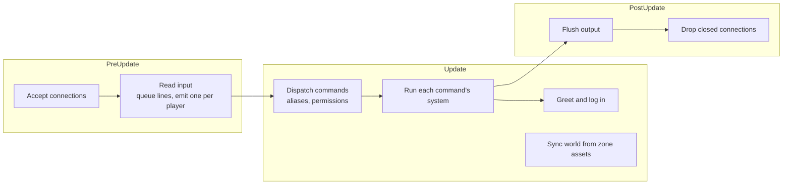

# Architecture

[Design summary](README.md) · Status: the server below is built; the [foundation](#foundation-still-needed) is proposed

The server is a headless Bevy app: no window or renderer, just the ECS, the app loop, logging and asset loading. Players connect over telnet. Designed content (the world, later skills) lives in hot-reloaded RON files; anything that changes during play lives in SQLite.

## The server today

### Running it

```sh
cargo run                       # listens on 0.0.0.0:4000, database mud.db
MUD_ADDR=127.0.0.1:5000 cargo run
MUD_DB=/tmp/test.db cargo run
nc localhost 4000               # or telnet, TinTin++, Mudlet
```

`cargo run` matters: it is how Bevy finds the project's `assets/` folder.

### Modules

| Module | Responsibility |
| --- | --- |
| `main.rs` | Builds the app: a 30 Hz loop, logging, asset loading with file watching, and the plugins below |
| `net.rs` | TCP listener; one entity per connection with a `Connection` component; queues each client's lines and hands out one per tick as a `PlayerInput` message; flushes output at the end of the frame |
| `login.rs` | Login state machine: account, password (hidden with telnet echo control), new accounts, character choice, and character creation (race, Karma, background, description) |
| `command.rs` | The command system: `CommandSpec` registry, the dispatcher (alias expansion, permission hiding, unknown commands), generated `help`, and prompts |
| `commands/` | Player commands, one system each: `movement` (look, go, directions), `communication` (say, whisper, yell, gossip, who), `character` (score, raise, alias, unalias, quit) |
| `build.rs` | Builder and admin commands, registered with a permission |
| `targeting.rs` | `Keywords` and `Target`: resolving `goblin`, `2.goblin`, `all.coin`, `me` |
| `output.rs` | Shared output plumbing: `Outgoing`, `deliver`, `Actor`, the common queries, target candidate lists |
| `world.rs` | Zone assets (rooms, doors, item and mob templates, spawns), room entities, the `RoomIndex`, and `sync_world`, which applies zone changes live |
| `items.rs` | Item entities, Bulk and placement rules, persistence, and the item commands |
| `mobs.rs` | Mob entities, wandering and crowding, `summon` and `purge` |
| `spawns.rs` | Spawns for mobs and items: timers, breeding, counting by origin, container contents, unique items |
| `events.rs` | `GameEvent`, the shared vocabulary of things that happen, and the room announcements made from them |
| `time.rs` | The game clock, parts of the day, `time`, and the one-second heartbeat |
| `skills.rs` | Skill trees (`.skill.ron` assets), each character's `Skills`, progression, `Practice` for commands that use skills, passive triggers, `skills`, `use` and `grantskill` |
| `vitals.rs` | Current health and stamina, recovery, saving them, the status prompt and `prompt`, and the admin `setvitals` |
| `db.rs` | SQLite: accounts, characters, roles, aliases, attributes, real items, spawn timers |
| `aliases.rs` | Per-character aliases |
| `attributes.rs` | Attributes, Karma costs, `score` and `raise` |
| `characters.rs` | Races and backgrounds, loaded from `assets/races.ron` and `assets/backgrounds.ron`, and the creation menus |
| `conditions.rs` | The shared condition language (`Stat`, `Race`, `All`, `Any`, `Not`) |
| `dice.rs` | The `Dice` resource, the only source of randomness |

### One tick



- **One line per player per tick** keeps each player's commands in the order typed, even when different systems handle them, and limits anyone to 30 commands a second.
- **Output is queued** on each `Connection` during the frame and written once at the end.
- **The connection owns the prompt.** In game, each batch of output ends with exactly one `> `, text arriving while the prompt is showing starts on a fresh line, and an empty Enter gets a new prompt. Commands and notifications never write prompts themselves.

### Data

| Kind | Where | Reloads |
| --- | --- | --- |
| World | `assets/zones/<zone>.ron`, one file per zone; builder commands write back to them | Live, on file change |
| Accounts, characters, roles | `accounts`, `characters` tables | n/a |
| Aliases | `character_aliases` table | n/a |
| Attributes | `character_attributes` table | n/a |

Tables are created with `CREATE TABLE IF NOT EXISTS`. The next change to an existing table needs numbered migrations (`PRAGMA user_version`).

## Foundation still needed

The skill design depends on things the server doesn't have: targets, items, events and time. These pieces come first.

### Command system and targeting (built)

Each command is registered with a `CommandSpec` (name, short forms, category, permission, usage, summary) and its own Bevy system, which receives an `Invocation` and asks for exactly the resources it needs:

```rust
app.add_command(
    CommandSpec::new("whisper", Category::Communication)
        .usage("whisper <player> <text>")
        .summary("speak privately to someone in the room"),
    communication::whisper,
);
```

- **One dispatcher** expands aliases, hides commands a player lacks permission for (they get the same "Huh?" as a typo), and queues the command's system. The prompt is sent after the command's output, so handlers never send it.
- **`help`** is generated from the registry, grouped by category and filtered by role; `help <command>` shows usage.
- **Targets** are resolved by `Target::parse` and `find_one` / `find_all` over candidates with `Keywords`: a word matches the start of any keyword, `2.x` picks the second match, `all.x` every match, and `me` the player. Others are preferred; the player is the fallback when only they match. Today the candidates are players; items and mobs join when they exist.

### Things in the world

Items and mobs are entities made from templates in zone files. Items have an `ItemLocation` (a room, hands, a wear slot, or inside another item); mobs share players' `InRoom`, so queries that mean only one of them filter on `Connection`. Items, containers, locks, persistence and decay are in [Items, containers and locks](items.md); mob templates, spawns, resets, wandering and doors in [The living world](world.md). Builders edit templates with `item` and `mob`, and spawns with `spawn`.

### Game events

Started. One vocabulary of game events, the `GameEvent` message in `events.rs`, written by whichever system makes something happen. Passive-skill triggers, hidden-skill triggers, quests, world events and easter-egg flags all listen to the same events, so new content adds events, not special cases.

| Event | Written by | Heard by |
| --- | --- | --- |
| `Left`, `Entered` (with `Way::Walked(direction)` or `Way::Teleported`) | Walking, `goto`, wandering mobs | The room announcements: "A stray dog leaves east.", "Gandalf arrives from the west." |
| `PhaseChanged(phase)` | The game clock | Announcements to everyone outdoors |

More arrive as their systems do: `ItemPickedUp`, `DoorOpened`, `Attacked`, `DodgeSucceeded`, `ManaSpent`, `DamageTaken`, `Died`.

### Time

Started.

- **The game clock** runs eight times faster than real time: a full day and night every **3 real hours**, a game hour every 7½ real minutes. It's worked out from the real time, so it needs no saving and a restart doesn't move it.
- **Parts of the day:** dawn from 5, day from 7, dusk from 19, night from 21. Each begins with a message to everyone outdoors; rooms flagged `indoors` (the sewers, the guildhall, the keep's halls) don't see it. `time` shows the hour, read from the sky or guessed indoors.
- **One heartbeat, once a second,** for systems that don't need every frame: spawns, wandering and the clock today; regeneration and cooldowns later. Heartbeat systems work from elapsed time and timestamps, never by counting beats, so the rate is a performance setting rather than a game rule, and a stalled server doesn't change the game. There's no old-style global tick to wait for.
- **Recovery** of health and stamina runs on the heartbeat (see [Vitals](attributes.md#vitals)).
- **Still to come:** combat rounds (2-3 seconds, with combat), and actions that take time to finish (lessons, rituals, casting).
- **Open:** a calendar (days, months, seasons) from *The Agryn's Legacy*, and whether night changes anything beyond the messages, such as needing light outdoors.

### Combat

The round loop, initiative, damage, death and respawn: infrastructure with no actions of its own. Every action in combat is a skill, starting with the basic attack every character has (see [Skill kinds](skills.md#skill-kinds)), so combat is built together with the skill core. Every roll goes through `Dice`, and every contest follows the [ratio rule](attributes.md#the-ratio-rule).

## Planned features

Features that are designed but wait on other work.

### Game masters and puppeting

Admins, and a new **GM (game master) role**, can **puppet** any mob: take it over and play it themselves until they release it. A GM can voice the goblin king during a raid, have a town guard question a suspicious player, or walk the dragon out of its lair for an event.

```
> puppet king
You take control of the goblin king.
[as the goblin king] > yell Who dares enter my halls?
[as the goblin king] > release
You release the goblin king and return to yourself.
```

- **Commands run as the mob.** While puppeting, the GM's commands act through the mob: it moves, speaks, fights and uses its skills under its own name, with its own attributes, skills and inventory. The GM sees everything the mob would see. The prompt shows who they're playing, so it can't be forgotten.
- **The mob's own behaviour pauses.** It stops wandering and acting on its own, and resumes when released.
- **The GM's own character stays put,** idle where it was left. Other players can't tell anyone is puppeting; to them it's just the mob.
- **Release** with `release`, or automatically when the mob dies or the GM disconnects. The GM returns to their own character.
- **Limits:** only mobs, never another player's character; one puppeteer per mob at a time.
- **Every puppeting session is logged** (who, which mob, when, and what they did), so the power is accountable.
- **How it fits the code:** a `Puppeting(mob)` component on the GM's connection makes the command dispatcher send each `Invocation` on behalf of the mob, and routes the mob's output back to the GM. This depends on mobs using the same command systems as players, which the design already intends (mobs fight with skills, by the same rules).

**Waits on mobs.** The GM role itself, and the open question of where it sits among the roles, are in [Open questions](#open-questions).

### Scripting

An escape hatch for behaviour that data can't express: bespoke unique items (Angorim glowing when orcs are near), unusual skill effects, quest logic, complex mob behaviour, odd easter eggs. Most content stays data; an item, skill, mob or world event can name a script instead of, or alongside, its data.

- **Waits on what scripts would talk to:** the effect system, mobs, and game events. Embedding a language before those exist would mean designing its interface in a vacuum.
- **Language: to decide when it's built.** Candidates:

  | | [Steel](https://github.com/mattwparas/steel) (Scheme) | [Rhai](https://rhai.rs) | Lua ([mlua](https://github.com/mlua-rs/mlua)) |
  | --- | --- | --- | --- |
  | Written in | Rust | Rust | C, wrapped for Rust |
  | Syntax | Lisp; macros could make a custom content language | Close to Rust and JavaScript | The traditional MUD scripting language |
  | Stopping runaway scripts | Only an interrupt flag the host sets, e.g. from a watchdog | Built-in limits on operations, call depth, sizes | Instruction-count hooks |
  | Threads | Single-threaded engine (a non-send Bevy resource); a `sync` build option exists | Optional thread-safe build | One thread per VM |
  | Maturity | Pre-1.0 (0.8.3), API may change | Stable | Very mature |

- **Measured for Steel (0.8.3):** about 90 ns per call from Rust into a script function (100,000 calls in 9.3 ms), with the engine running in sandboxed mode.
- **Requirements whichever language wins:** scripts can't hang the server (an operation limit or watchdog), can't reach the file system or network, only call the game through functions the server registers, and reload live like zone files.

### Status prompt

Built, except the IAC GA marker. The in-game prompt shows the character's state, such as `<14/18hp 9/10st>`, instead of a bare `> `.

- **Always current.** The connection writes the prompt once at the end of each tick (see [One tick](#one-tick)), so it is built fresh from the character's state every time, including damage taken between the player's own commands.
- **Built by the game, shown by the connection.** A system just before output is flushed computes each player's prompt text and hands it to their `Connection`. `net.rs` only knows how to show "the current prompt", never game rules.
- **Customisable per character,** saved like aliases, with placeholder codes and a default for new characters:

  ```
  prompt <%h/%Hhp %s/%Sst>       ->   <14/18hp 9/10st>
  prompt                          ->   back to the default
  ```

- **Recognisable by MUD clients.** Marking the prompt with telnet IAC GA lets clients like Mudlet and TinTin++ draw gauges or pin the prompt. Raw `nc` would show stray characters, so it is sent only to clients that ask for it.
- **Built on [vitals](attributes.md#vitals):** `vitals.rs` fills in each player's prompt just before output is flushed, and `Connection` only shows whatever it was given. `%%` is a literal percent sign; a space is kept after the prompt so typing doesn't run into it.

## Proposed build order

1. ~~**Command system and targeting.**~~ Built.
2. **Things in the world, templates and resets.** [Items](items.md) first (with containers, locks and doors), then mobs that stand in rooms and can be looked at. *Built.*
3. **Game events and time.** Both small, but everything after this uses them. *Started: the clock, the heartbeat, and movement and day events.*
4. **The [skill core](skills.md#build-plan), with combat as its first use.** *Core built without combat; combat next.* The round loop is built alongside it, and the basic attack is the first skill. Starting skills from [race and background](characters.md) arrive here too.

Then teaching, epiphany, trainers and loot follow: trainers are mobs, loot scrolls are items, and passive skills have events to trigger on.

## Open questions

- [ ] **Where does the GM role sit?** Roles are currently ordered (player < builder < admin), each including everything below it. A GM could slot in as player < builder < GM < admin, or be a separate permission, so a GM needn't be able to build and a builder needn't be able to puppet.
