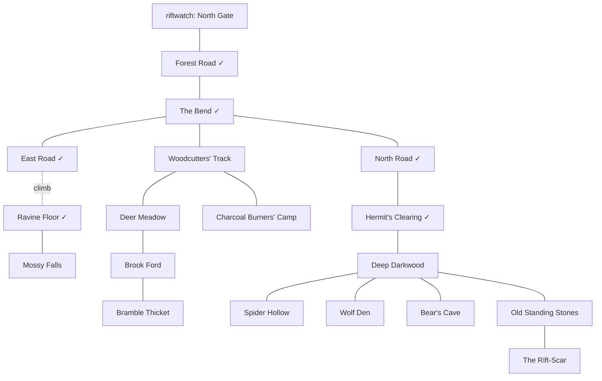

# The Darkwood

[Design summary](README.md) · Status: a design (2026-10-27). Built: the road north from the gate, the Bend, the East Road and the Ravine Floor, the North Road and the Hermit's Clearing with its hedge-shaman (zone `forest`). Everything else here is proposed, for review.

The Darkwood is the first wilderness: the forest beyond Riftwatch's North Gate. It's where a new character goes once the sewers stop teaching them anything, and where foraging, herb-gathering, tracking and hunting come into their own. It grows more dangerous the further from the road you go: safe-ish near the gate, wild in the deep wood, and strange where the trees grow wrong around an old rift-scar.

**Built as data, wherever it can be.** Most of this is rooms, mob templates, spawns, finds and skills in RON, using what exists: allies and packs, reactions and conditions, Call for Help, breeding spawns. Where something can't be done in data, it's marked **(gap)** and collected in [What needs code](#what-needs-code), which is also the list the [scripting](effects.md#scripting) step is designed against.

## Map

About twenty rooms, in four reaches out from the Bend. Existing rooms are marked ✓.

| Reach | Rooms | Feel | Danger |
| --- | --- | --- | --- |
| **The road** ✓ | Forest Road, the Bend, North Road, East Road | Travellers' way; tracks of everything | Low: the odd boar wandering in |
| **The west woods** | Woodcutters' Track, Charcoal Burners' Camp (abandoned), Deer Meadow, Brook Ford, Bramble Thicket | Logged-over, open, sunlit; game and herbs | Low to middle: boar, the meadow's grazers |
| **The ravine** | Ravine Floor ✓, Mossy Falls (a swim behind the falls to a hidden ledge) | Damp, green, quiet; the best herbs | Low, but a climb and a swim to reach |
| **The deep wood** | Deep Darkwood (several rooms of it), Spider Hollow, Wolf Den, Bear's Cave, Old Standing Stones | Dark, old, close; little light | Middle to high: wolves, a bear, spiders |
| **The rift-scar** | The Rift-Scar | A glade where the trees grow wrong and the air hums | High, and rare: the rift-touched |

- **Environments:** `Forest` everywhere but the Deer Meadow (`Field`), Brook Ford and Mossy Falls (`Water` for its pool), and the Bear's Cave (`Cave`).
- **Terrain:** road on the road; uneven tracks; rough deep wood, thicket and scree; mud at the ford (easy tracking); wading at the brook and the pool (no tracks).
- **Climbs and swims:** the ravine (Climb 4, built), a swim behind Mossy Falls to a ledge with rare herbs (Swim 4), and a climb up the standing stones' hill.

## Fauna

Each creature with what it does and which existing data does it. Numbers are first guesses, set against the sewer rats (Body 1, health 3) and the town guards (Body 6, level-10 skills).

| Creature | Where | How it behaves | Built from | Harvest |
| --- | --- | --- | --- | --- |
| **Rabbit** | Meadow, west woods | Breeds fast, harmless; bolts from anyone **(gap: flee)** | Breeding spawn, `crowd`, `tags: ["game"]`; *Skittish* (see [Prey](#prey-a-window-then-gone)) | Meat; a rabbit pelt |
| **Red deer** | Meadow, brook | A small herd, wandering the west woods; bolts **(gap: flee)**; a stag fights back hard | Breeding spawn with `reseed`; `tags: ["game"]`; the stag a `Keep(1)` spawn with a gore attack; *Skittish* | Venison; a hide; antlers (stag) |
| **Wild boar** | Thicket, west woods, the road now and then | Bad-tempered: attacks anyone not a boar; **enrages** when hurt | `aggressive`, `allies: ["boar"]`; passive skill *Boar's Fury*: reaction `Hurt(0.5)` → `Apply(strengthened)` on itself | Pork; a tusk |
| **Grey wolf** | Wolf Den, the deep wood (more at night **(gap: time-of-day spawns)**) | Hunts in packs of three; goes for game and travellers alike; **howls** for the pack when hurt | `aggressive`, `allies: ["wolf"]`, `pack: 3`, `tags: ["wolf"]`; *Howl*: Call for Help with the wolves' own words | A wolf pelt; fangs |
| **The old she-wolf** | Wolf Den | The pack's leader: while she lives, every wolf in the Darkwood fights better | An `Aura` skill, as the Rat King's, affecting `forest:grey_wolf`; `AfterDeath(Days(7))` | A great grey pelt (rare) |
| **Forest spider** | Spider Hollow | Waits in its web **(gap: mobs hiding and ambushing, #9)**; a bite that poisons | `aggressive`; passive *Venomous Bite*: reaction `Hits` → `Apply(poisoned)` | Spider silk; a venom sac |
| **Brown bear** | Bear's Cave | Solitary and huge; ignores you on the paths, savage at home **(gap: territorial)** | `wander: Never`, high Body and Strength, natural armour (*Thick Hide*: `Armour` bonus), a maul | A bear pelt; claws, bear meat |
| **Crows** | The road, the clearing | Atmosphere: they watch, and caw **(gap: ambient lines)** | A `here` line, `wander: Zone` | Nothing |
| **The rift-touched stag** | The Rift-Scar | Rare and strange: glowing antlers, lightning-quick; what hurts it hurts back | A `rift_touched` condition (resist force, `Struck` → force damage, as thorns), granted by its template's natural state **(gap: conditions a mob starts with)**; `AfterDeath(Days(3))`; a Silver contract later | A rift-glass antler (rare, a crafting reagent later) |

**Food chain, from what's built:** wolves and boars are `aggressive` with allies of their own kind only, so they go for deer and rabbits as readily as players; deer and rabbits aren't aggressive, so they're prey. Without fleeing, prey just stands and dies, which is why fleeing is the first gap worth closing.

### Prey: a window, then gone

Decided 2026-10-27. Deer and rabbits bolt, but not the instant someone walks in: there's a window a quick hunter can strike into, so taking one is a little hard, not wildly so, and a slow typist still has a fair chance.

- **Startled, then off.** A non-ally the prey notices coming in startles it (`startled`, a condition lasting a few seconds); when that runs out, it flees. In data, a passive *Skittish*: `Arrives` → `Apply(startled)`, and `startled`'s own `Fades` → `Flee`. How long the window lasts is the condition's length: a tuning number, first guess 6 seconds (two rounds).
- **Caught in the window, it fights to get away:** once in a fight, prey tries to break off as a player does with `flee`, a chance each turn rather than a certainty, and more likely once hurt (`Hurt(0.5)` → `Flee`). A hunter usually gets a blow or two in.
- **Stealth pays.** `Arrives` fires only for someone the prey noticed, so a sneaking hunter walks right up without startling it; a sharp-eyed deer (good Intuition) notices more.

### Harvest, not loot

Decided 2026-10-27. **A beast's corpse drops no materials.** Its pelt, meat, fangs and antlers are worked out of it with a skill, while it lasts (a mob's corpse rots in 5 minutes). Loot tables stay for what a creature carries: a bandit's knife, a guard's coins.

- **Two new Survival skills,** made of effects: **Skinning** (hides, pelts, silk) and **Butchering** (meat, and trophies: fangs, tusks, antlers, claws, a venom sac). Each is `Find` aimed at a corpse, the user's skill against its difficulty, the better made the more surely it went, as foraging is.
- **In data,** a creature's template says what its corpse yields, by kind: `harvest: {"hide": [("wolf_pelt", 1)], "meat": [(None, 20), ("wolf_meat", 80)]}`, and Skinning finds `"hide"`, Butchering `"meat"`. Each kind can be taken from a corpse once; a fumble spoils it.
- **The corpse's rot timer is the window** for harvesting, and a corpse taken whole could be carried home to work later (it's an item).
- **The sewers too:** sewer rats drop a rat's tail as loot today, and the Rat King his tooth. Both are an animal's, so they move to harvesting once it's built.

**New natural attacks** (data, `beast.skill.ron`): a wolf's bite (2–4), a boar's gore (2–5, with a knock-down technique, *Charge*: `Apply(down)`), a bear's maul (3–6), a stag's antlers (2–5), a spider's fangs (1–3).

**New passives** (data): *Boar's Fury*, *Venomous Bite*, *Thick Hide*, *Howl*, and *Pack Hunter* (wolves get an attack bonus with more of the pack in the fight **(gap: a bonus that counts allies present)**).

## Flora

The forest's finds, by place: the existing tables stay, and the deep wood and the ravine get the rarer things.

| Where | Forage | Herbs | New kinds (later skills) |
| --- | --- | --- | --- |
| The road, west woods | Wild berries, hazelnuts, wild garlic | Yarrow | `"wood"` for Woodcutting |
| Deer Meadow | Wild berries, sorrel | Yarrow, kingsfoil, chamomile | |
| Brook Ford, Mossy Falls | Watercress | Kingsfoil, moonpetal | `"fish"` for Fishing |
| Ravine, the falls' ledge | Mushrooms | Moonpetal, frostfern (rare) | |
| Deep wood | Mushrooms, deathcap (poisonous to eat) | Foxglove, nightshade (poisons, for Brewing later) | `"wood"` (ironbark) |
| The Rift-Scar | Nothing wholesome | Riftbloom (rare, glows) | |

- **All data:** each is an item template plus a finds table; new kinds like `"wood"` and `"fish"` are just tables until a skill finds them (Woodcutting, Fishing: new skills made of `Find`).
- **Poisonous food** (deathcap): eating it should poison you **(gap: consumables that apply conditions)**. Food today only heals or speeds recovery.
- **Honey from a bee tree:** foraging it angers the bees **(gap: a find with a consequence)**.

## Hazards and atmosphere

- **Bramble Thicket:** pushing through scratches **(gap: room reactions: `Enters` → `Damage`)**, and it's rough going.
- **Spider Hollow's webs:** walking in, you may be caught (`held`) **(gap: room reactions)**.
- **The deep wood is dark:** hard to see in, and harder at night **(gap: room conditions, darkness and sight)**. A torch would help (torches are planned items).
- **Getting lost** in the deep wood without Navigation **(gap, later: a Navigation skill and lost-ness)**.
- **The Rift-Scar** hums: anyone who lingers is slowly worn down, unless warded **(gap: room conditions with `Every` reactions)**.
- **Night** changes the forest: more wolves, fewer deer **(gap: time-of-day spawns)**.

## People and work

- **The hedge-shaman** ✓ in the Hermit's Clearing: Awakens Shamans, teaches Tracking.
- **A hunter** at the Charcoal Burners' Camp, newly moved in: teaches Foraging and, later, Bows **(gap: ranged combat)**; buys pelts and meat. A shop is data.
- **What sells:** the provisioner buys meat (food), the herbalist herbs; the hunter pelts, fangs and antlers, all of them harvested, not looted. The hunter teaches Skinning and Butchering. Item values and shop `buys` are data.
- **Contracts** (when quests exist, [Quests](quests.md)): cull the wolves (Copper), bring the old she-wolf's pelt (Bronze), the rift-touched stag (Silver).

## What needs code

The gaps above, each with the smallest shape that would close it, in the order they'd matter for the Darkwood:

| Gap | Needed for | Proposed shape | Size |
| --- | --- | --- | --- |
| **Fleeing** | Deer and rabbits, a hurt wolf breaking off | A `Flee` effect, as the `flee` command: out of a fight, the bearer leaves by a random walkable exit; in one, a chance to break away. Then data does the rest: *Skittish* puts `startled` on at `Arrives`, and `startled` `Fades` → `Flee`, which makes the window ([Prey](#prey-a-window-then-gone)). `Arrives` fires for anyone coming in, other deer too, so it also needs a check on the trigger, "only if they aren't an ally": the trigger checks [effects.md](effects.md#reactions-as-built) lists as still to come. | Small to medium |
| **Harvesting corpses** | Pelts, meat, fangs, antlers | `harvest` tables on mob templates, carried onto the corpse; `Find` aimed at a corpse (`aim: Item`) finding a kind from it, once per kind; Skinning and Butchering as data | Small to medium |
| **Mob conditions from the start** | The rift-touched stag; any template that "is" something | `conditions: [("rift_touched", 2)]` on a mob template, put on as it spawns, lasting `Indefinitely` | Small |
| **Consumables that apply conditions** | Deathcap poisoning, later potions of strength | `effects: [...]` on a `consumable`, resolved as an active skill's are, on the eater | Small |
| **Time-of-day spawns** | Night wolves, day deer | The spawn `when` condition gains `TimeOfDay(Night)` (designed in [world.md](world.md)) | Small |
| **Ambient lines** | Crows, the hum of the scar, birdsong | `chatter: ["The crow caws.", ...]` on a mob or room, one now and then on the heartbeat | Small |
| **Territorial aggression** | The bear | `aggressive` only in its spawn's room: `aggressive: Home` | Small |
| **Room conditions and reactions** | Thickets, webs, darkness, the Rift-Scar's hum | Rooms carry conditions as characters do; their reactions fire on `Enters` and `Every` for whoever is there | Medium |
| **Mobs hiding and ambushing** | The spider in its web | Issue #9: mobs use Stealth out of a fight, and open from hiding | Medium |
| **A bonus that counts allies present** | *Pack Hunter* | A passive bonus `per` ally in the fight, or a formula input `allies` | Small to medium |
| **Ranged combat** | Bows, the hunter's teaching | Attacking into the next room, ammunition | Large, later |
| **Navigation and getting lost** | The deep wood | Later | Medium, later |

## Proposed build order

1. **Rooms and flora** (data): the west woods, the ravine's falls, the deep wood, the stones and the scar, with their finds and the new herb and food items.
2. **The fauna that works today** (data): boars with *Boar's Fury*, wolves with *Howl* and the old she-wolf's aura, spiders with *Venomous Bite*, the bear with *Thick Hide*, the deer and rabbits as breeding prey, crows. No material loot: what they yield waits for harvesting.
3. **Harvesting** (code, small to medium): `harvest` tables and `Find` from a corpse, then Skinning and Butchering as data.
4. **Fleeing** (code, small to medium), with the startled window, then deer and rabbits bolt and a beaten wolf runs.
5. **Mob starting conditions** (code, small), for the rift-touched stag; **consumables with effects** for deathcaps.
6. **Time-of-day spawns** and **ambient lines** (code, small).
7. **Room conditions and reactions** (code, medium), for the thicket, the webs and the scar; mobs hiding (#9) for the spider's ambush.

## Open questions

- [ ] **Levels:** where should a character be to survive the deep wood: guard-strength (level-10 skills), or more?
- [ ] **How many rooms of deep wood:** a handful, or a small maze (and does getting lost matter)?
- [ ] **The rift-scar:** a hint of the wider story now, or held back until the setting is decided ([Riftwatch](riftwatch.md#open-questions))?
- [ ] **The hunter:** a new trainer and shop at the camp, or the provisioner and the drill sergeant cover it?
