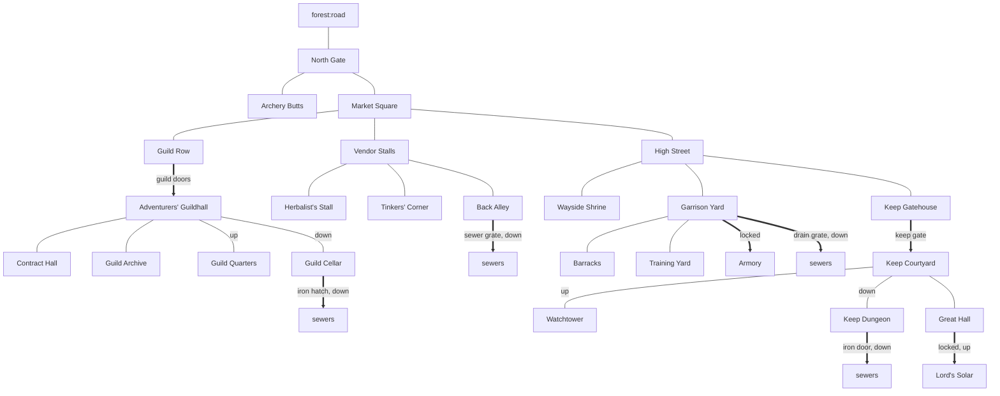
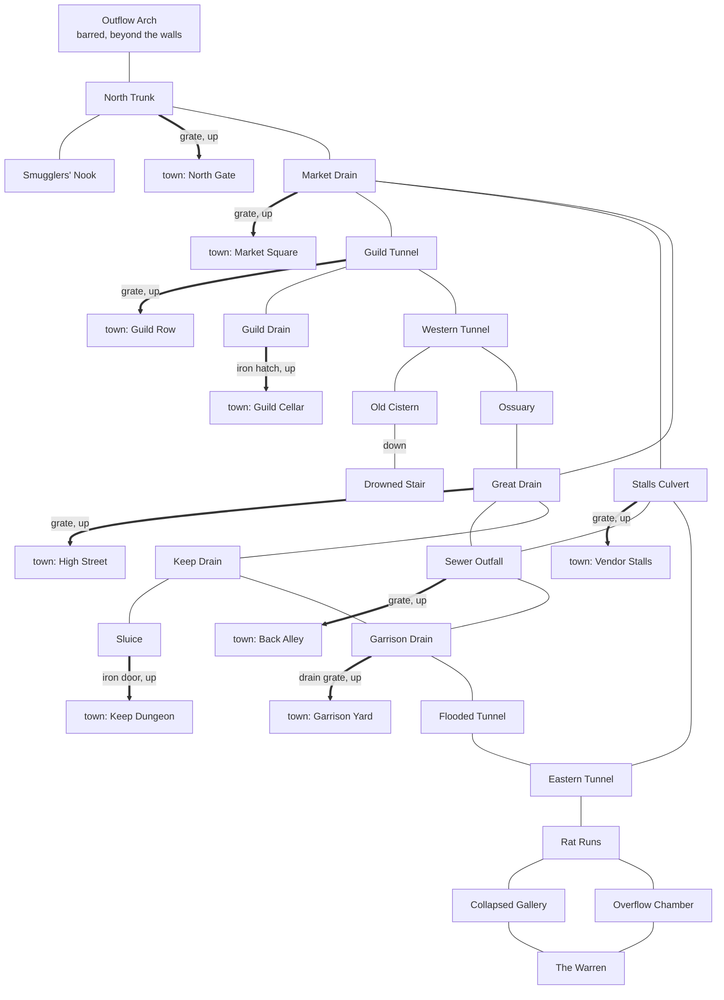

# Riftwatch

[Design summary](README.md) · Status: rooms, doors, mobs and trainers built (zones `riftwatch`, `sewers`, and `forest` for the road north), and the rats breed

Riftwatch is the starting town. Every new character begins in its market square, and it's the hub players return to between ventures. It holds the Adventurers' Guild, an open-air market, the garrison, the lord's keep, and beneath it all a sewer system as large as the town itself: 25 rooms above, 23 below, joined by nine grates, hatches and doors. Room descriptions only lightly touch the setting (the barrier's shimmer from the watchtower, adventurers drawn by the rifts); change anything that doesn't fit *The Agryn's Legacy*.

## Map

North is up: the North Gate opens onto the forest road, the market is the centre, the guild lies west, the stalls east, and High Street runs south to the garrison and the keep.

## The sewers

The sewers mirror the town above, a tunnel beneath each district, and loop rather than dead-end, so the rats have room to spread.

| Under | Sewer rooms |
| --- | --- |
| North Gate | Outflow Arch, North Trunk, Smugglers' Nook |
| Market | Market Drain, Stalls Culvert, Sewer Outfall |
| Guild | Guild Tunnel, Guild Drain, Western Tunnel, Old Cistern, Drowned Stair |
| High Street and shrine | Great Drain, Ossuary |
| Keep | Keep Drain, Sluice |
| Garrison | Garrison Drain, Flooded Tunnel |
| East, the rats' territory | Eastern Tunnel, Rat Runs, Collapsed Gallery, Overflow Chamber, The Warren |

Nine ways connect the sewers and the town. The street grates are closed but unlocked, so anyone can climb down, and rats can come up once one is left open:

| From town | Down to | Starts |
| --- | --- | --- |
| North Gate | North Trunk | Closed |
| Market Square | Market Drain | Closed |
| Guild Row | Guild Tunnel | Closed |
| High Street | Great Drain | Closed |
| Vendor Stalls | Stalls Culvert | Closed |
| Back Alley | Sewer Outfall | Closed |
| Garrison Yard | Garrison Drain | Locked |
| Guild Cellar | Guild Drain | Locked |
| Keep Dungeon | Sluice | Locked, very hard to force |

From any room, `look <direction>` shows what lies that way and who's there, including through an open grate.

## Districts

| District | Rooms |
| --- | --- |
| Gate | North Gate, Archery Butts |
| Market | Market Square (start room), Vendor Stalls, Herbalist's Stall, Tinkers' Corner, Back Alley |
| Guild | Guild Row, Adventurers' Guildhall, Contract Hall, Guild Archive, Guild Quarters, Guild Cellar |
| High Street | High Street, Wayside Shrine |
| Garrison | Garrison Yard, Training Yard, Barracks, Armory |
| Keep | Keep Gatehouse, Keep Courtyard, Watchtower, Great Hall, Lord's Solar, Keep Dungeon |
| Sewers | 22 rooms; see [The sewers](#the-sewers) |

## Doors

| Door | Between | Starts | Lock |
| --- | --- | --- | --- |
| A pair of iron-banded doors | Guild Row, Guildhall | Open | None |
| Five street grates | See [The sewers](#the-sewers) | Closed | None |
| A rusted sewer grate | Back Alley, Sewer Outfall | Closed | None |
| A reinforced armory door | Garrison Yard, Armory | Locked | Pick 8, bash 20 |
| An iron-studded gate | Keep Gatehouse, Keep Courtyard | Open | Bash 40, can't be picked |
| A carved oak door | Great Hall, Lord's Solar | Locked | Pick 10, bash 25 |
| An iron hatch | Guild Cellar, sewers' Guild Drain | Locked | Pick 6, bash 15 |
| A barred drain grate | Garrison Yard, sewers' Garrison Drain | Locked | Pick 6, bash 20 |
| A rusted iron door | Keep Dungeon, sewers' Sluice | Locked | Pick 12, bash 40 |

None of the locks have keys yet; keys arrive with items.

## Who's about

| Spawn | Where | Keeps | Wanders |
| --- | --- | --- | --- |
| Town guards | North Gate | 2 | Anywhere in town, every 1-3 minutes |
| A stray dog | Market Square | 1 | Market, stalls, back alley, tinkers, Guild Row |
| The contract clerk | Contract Hall | 1 | No |
| The herbalist | Herbalist's Stall | 1 | No |
| The drill sergeant | Training Yard | 1 | No |
| Sewer rats (aggressive: they attack anyone who comes near) | The Warren | Breed from 8, doubling every 4 hours up to 200; back a week after they're wiped out | Anywhere, through open grates too, but only when crowded: 6 to a room |

The herbalist's stall, Contract Hall, Guild Archive, Guild Quarters, shrine and Lord's Solar turn wanderers away.

Item spawns keep a few things in place:

| Spawn | Where | Keeps | Resets |
| --- | --- | --- | --- |
| A weathered signpost (fixed) | Market Square | 1 | Every hour |
| An old oak chest (fixed, locked), with two loaves of bread, a waterskin and a torch | Guild Cellar | 1 | Every hour, topping up its contents |
| Wooden practice swords | Training Yard | 2 | Every 30 minutes |
| A rolled parchment | Guild Archive | 1 | Every 2 hours |

The chest's key isn't spawned anywhere yet; it's meant for a mob to carry once mobs carry things.

## Where trainers go

Each basic skill has a home in town. Trainers teach Common and Uncommon skills (see [Acquiring skills](skills.md#acquiring-skills)).

| Room | Trainers (planned) |
| --- | --- |
| Training Yard | The drill sergeant: the basics of every weapon (Swordplay, Knife, Axe, Hammer and Staff Fighting), Toughness, Climbing, Swimming, Heavy Armour and Block. *Built* |
| Archery Butts | Archery |
| Guild Archive | The magister, who Awakens Hermetic students (*built*); later Lore, and the self-taught **Study** path |
| Herbalist's Stall | The herbalist: Herbalism, Foraging and First Aid (*built*) |
| Wayside Shrine | The keeper of the shrine, who Awakens Divine students (*built*); later Healing, and the **Devotion** path |
| Back Alley | A hooded figure: Stealth, Lockpicking and Pickpocketing (*built*) |
| Tinkers' Corner | Crafting and repair |
| Market stalls | The provisioner: Haggling and Appraisal (*built*) |
| Watchtower | An old ascetic, who Awakens Adepts (*built*) |
| Darkwood, Hermit's Clearing | Outside town: the hedge-shaman, who Awakens Shamanic students and teaches Tracking (*built*); see [The Darkwood](darkwood.md) |
| Contract Hall | Not a trainer: the guild's contract board and clerk (see [Quests and the Adventurers' Guild](quests.md)) |

Guild trainers beyond these can require a guild rank, such as a weaponmaster who only teaches Silver members; the ones above stay open to everyone.

## The rat problem

The sewers are built for the breeding spawn described in [The living world](world.md#spawns-and-resets):

- **The Warren** (`sewers:nest`) is the nest. Rats breed there and spread by crowding, first through the Rat Runs, Collapsed Gallery and Overflow Chamber, then into the rest of the sewers.
- **Six street grates lead up,** all closed at the start. Left alone, rats crowd toward them; an open grate lets them into the street above. The locked ways up (guild, garrison, keep) hold them back unless someone opens them.
- **They fight in threes.** Rats are aggressive, but no more than three take on one player at once (`pack: 3`); the rest wait their turn. Tuned by simulation against a fresh Soldier with his short sword: about two rats a trip in the Warren before resting at a third of his health, more one at a time in the outer tunnels, and about one under the Rat King. A rat's bite does a single point (`beast:rat_bite`).
- **A breakout raises the Rat King.** The first rat to reach the city through an open grate sets off an alarm in the streets, and the Rat King appears in the Warren, making every rat in the sewers tougher until someone kills him. See [The Rat King](world.md#the-rat-king-built).
- **Hooks for later:** the barred Outflow Arch (a way beyond the walls), the Smugglers' Nook (someone's been using it), the Ossuary under the shrine, and the Drowned Stair beneath the Old Cistern, which is far older than the sewers and carved in an unknown script.

## Open questions

- [ ] **The lord:** name, title and household, for the Great Hall and the Lord's Solar.
- [ ] **How Riftwatch fits the setting:** its place relative to the barrier and the rifts, and what the watchtower actually watches.
- [x] **Shops:** the herbalist, the provisioner in the Vendor Stalls and the tinker in Tinkers' Corner; see [Money and shops](economy.md#riftwatchs-shops).
