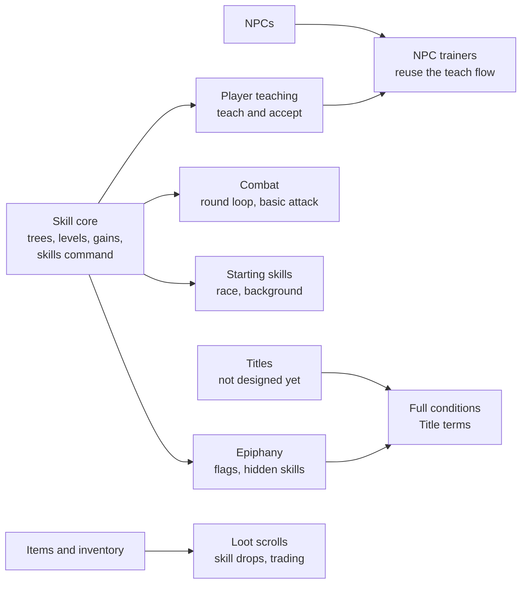

# Skills

[Design summary](README.md) · Status: designed, not built

Characters have no class. What a character can do is the set of skills they have learned, organized into skill trees. Every skill improves only by being used; how that works is in [Progression](progression.md).

## Skill trees and skills

A tree is a themed set of skills, and a character has "opened" a tree once they know any skill in it. There is no separate unlock step.

- **Levels.** Each skill has a level from 0 up to its `max_level`. Reaching `max_level` is **mastery**. Levels are permanent and never decay.
- **Requirements.** A skill lists the conditions a learner must meet, usually `Skill(id, level)`. They can point into other trees, which is how hybrid skills work. Requirements use the same [condition language](#hidden-skills) as hidden skills, so a skill can also require an attribute, such as Magic 1 for a tradition's foundation casting skill.
- **Requirements make a skill eligible, not learned.** Meeting them only means the character may acquire the skill, through teaching, loot or epiphany.
- **Skill ids** follow the zone convention: `basics` inside its own tree, `fire:basics` from another tree.
- **Each skill links to an attribute.** A skill's effectiveness is its level plus that attribute (see [Attributes](attributes.md)). Trees set a default `attribute`, and a skill can override it.

Trees live in data files, one per tree, hot-reloaded like zones:

```ron
// assets/skills/swordplay.ron
(
    name: "Swordplay",
    rarity: Common,
    attribute: Agility,
    skills: {
        "basics": (
            name: "Basic Swordplay",
            max_level: 50,
            teach_level: 10,
        ),
        "riposte": (
            name: "Riposte",
            rarity: Uncommon,
            requires: [Skill("basics", 15)],
            teach_level: 20,
        ),
        "flame_blade": (
            name: "Flame Blade",
            rarity: Epic,
            source: Loot,
            requires: [Skill("basics", 30), Skill("fire:basics", 20)],
        ),
    },
)
```

| Field | Default | Meaning |
| --- | --- | --- |
| `name` | required | Display name |
| `max_level` | 50 | Level at which the skill is mastered |
| `requires` | none | Conditions the learner must meet |
| `attribute` | the tree's | The attribute added to the skill's level |
| `rarity` | the tree's | Common to Legendary; may be higher than the tree's, never lower |
| `source` | `Trainer` | `Trainer` or `Loot`; see [Acquiring skills](#acquiring-skills) |
| `teach_level` | `max_level` | Level a teacher needs; ignored for `Loot` skills, which always need mastery |
| `kind` | required | `Active(...)` or `Passive(...)`; see [Skill kinds](#skill-kinds) |
| `difficulty` | 1.0 | Multiplier on the gain chance |
| `hidden`, `unlock`, `trigger`, `hint` | off | See [Hidden skills](#hidden-skills) |

## Skill kinds

Skills are either active, triggered by the player, or passive, applying automatically. Both progress through use: a passive skill's use is a game event it declares, usually an outcome, such as a dodge that succeeds or mana being spent.

| Kind | How it works | Examples | Counts as a use |
| --- | --- | --- | --- |
| Active | The player triggers it with a command | Riposte, Fireball, Forage | Each activation |
| Passive | Applies automatically: a reaction or a constant bonus | Dodge Mastery, Deep Mana, Toughness, Night Vision | Each time its trigger event fires |

```ron
"riposte": (
    name: "Riposte",
    kind: Active(command: "riposte", target: Enemy, cost: Fatigue(3), cooldown: 8),
    requires: [Skill("basics", 15)],
),
"dodge_mastery": (
    name: "Dodge Mastery",
    kind: Passive(triggers: [DodgeSucceeded]),
    attribute: Reaction,
),
"deep_mana": (
    name: "Deep Mana",
    kind: Passive(triggers: [ManaSpent(per: 10)]),   // one use per 10 mana spent
    attribute: Willpower,
),
```

- **Outcome triggers reward doing, not just being there.** Dodge Mastery improves when dodges succeed, not every time the character is attacked.
- **Amount triggers scale with the amount.** `ManaSpent(per: 10)` counts one use per 10 mana, so one large spell counts for more than a trivial one.
- **Two separate cooldowns.** An active skill's use cooldown (Riposte every 8 seconds) is combat balance. The gain cooldown limits how often any skill can level, active or passive.
- **Spells are active skills** whose cost is Drain, resisted by Willpower plus the tradition attribute (see [Magic](magic.md)).
- **What a skill does** (damage, bonuses, applied conditions) needs an effect system, designed together with combat.
- **Combat is made of skills.** There is no attack outside the skill system: everyone starts with a basic attack skill, and weapon trees begin with their own. NPCs fight with skills from their templates, by the same rules as players.
- **Racial abilities are skills too,** usually passive, requiring the race (see [Races](characters.md#races)).
- **Triggers use the shared game events.** Passive triggers, hidden-skill triggers and easter-egg flags all draw on one event vocabulary (see [Architecture](architecture.md#game-events)).

### Invoking active skills

Every active skill is invoked with `use <skill> <target>`. Players make their own shortcuts with aliases, which are a general command feature (already built) rather than part of the skill system:

```
alias fireball use fireball
fireball goblin        ->  use fireball goblin
alias fb use fireball
fb goblin              ->  use fireball goblin
```

- Anything typed after an alias is appended to its expansion.
- Aliases are saved per character, in the `character_aliases` table.
- They cannot shadow built-in commands, so `quit`, `help` and `look` always work.
- An expansion is not expanded again, so aliases cannot chain or loop.
- `alias` lists them, `unalias <name>` removes one; a character can have up to 50, each up to 200 characters.

## Rarity

Both trees and skills have a rarity tier. Rarity says how scarce something is, while `source` says how it can be obtained; the two are set independently.

- **A tree's rarity** governs opening the tree: how often its entry skills drop and how hard they are to find someone to learn from.
- **A skill's rarity** defaults to its tree's and may be raised, never lowered. A common tree can end in a legendary capstone, but a rare tree cannot have a common way in.

Working tiers, pending a decision on names:

| Tier | Drop rate | NPC trainers (proposed) | Shown as |
| --- | --- | --- | --- |
| Common | Frequent | In towns | Plain |
| Uncommon | Occasional | A few, in remote places | Green |
| Rare | Scarce | None | Blue |
| Epic | Very scarce | None | Purple |
| Legendary | Unique drops or quests | None | Gold |

Rarity is not protected by teaching limits. It is protected by time: high-tier skills have high teaching levels or require mastery, and level-scaled gain cooldowns make those levels take weeks to reach. A rare skill therefore spreads only as fast as new masters appear.

Tier rules live in `assets/config/rarity.ron`, hot-reloaded, so drop rates and colours can be rebalanced without a restart.

**Optional, later:** a worldwide cap on how many living characters may know a given legendary skill at once.

## Acquiring skills

Every skill can be taught, and every route checks the same thing: the learner must meet the skill's requirements, plus its unlock conditions if it is hidden. The learner does not need to have opened the skill's tree, so learning from a master is a way into a new tree.

| Route | Available for | Who or what | Notes |
| --- | --- | --- | --- |
| NPC trainer | `source: Trainer` | Trainers placed in rooms, each with a fixed list | Reliable; a reason to travel |
| Player teacher | All skills | A player at the skill's `teach_level`, or at mastery for `Loot` skills | `teach <player> <skill>`, then the student types `accept`; both in the same room |
| Loot | Mostly `source: Loot` | A scroll or tome item; using it teaches the skill and consumes it | Tradeable, so it feeds an economy |
| Epiphany | Hidden skills | The character meets the unlock conditions, and the trigger if one is set | See [Hidden skills](#hidden-skills) |
| Starting | Universal, racial and background skills | Granted at character creation | See [Races and backgrounds](characters.md) |

**Loot skills spread through masters.** A `Loot` skill enters the world only as a drop. The first owner must reach mastery, through the longest gain cooldowns, before anyone can learn it from them. New loot skills therefore stay scarce for a long time, and their first masters become well known.

## Hidden skills

A hidden skill is learned by **epiphany**: the moment a character meets its unlock conditions, and performs its trigger if it has one, they learn it with a message such as *"Something stirs in you... you have learned Moonlit Step."* Before that, the skill does not appear anywhere.

Unlock conditions are data, built from a small set of terms that other systems share:

| Condition | Met when |
| --- | --- |
| `Skill(id, level)` | The character knows the skill at that level or higher |
| `Stat(name, min)` | An attribute is at least `min` |
| `Title(id)` | The character holds the title |
| `Flag(id)` | A named flag is set on the character |
| `Race(id)` | The character is of that race |
| `All([...])`, `Any([...])`, `Not(...)` | Combinations of the above |

```ron
"moonlit_step": (
    name: "Moonlit Step",
    rarity: Epic,
    hidden: true,
    unlock: All([
        Skill("stealth:basics", 40),
        Skill("nature:herbalism", 20),
        Any([Title("night_wanderer"), Stat("agility", 18)]),
        Flag("drank_from_moon_pool"),
    ]),
    trigger: Some(UseSkill("stealth:basics", in_zone: "forest")),
    hint: false,
)
```

- **Flags carry the easter eggs.** Any system (a room event, a phrase spoken at an altar, a creature killed, a quest step) sets a named flag, and hidden skills just test for it. New easter eggs need new flags, not changes to the skill system.
- **Triggers are optional.** Without one, the epiphany fires as soon as the conditions are met. With one, it waits for a specific action, which gives players rumours to chase.
- **Teaching never bypasses the conditions.** Hidden skills can be taught like any other, but only to a student who meets the unlock conditions. That makes a master a shortcut past the trigger, not past the conditions.
- **Hints are per skill.** With `hint: true` the tree view shows a `???` slot; otherwise the skill is invisible until learned.
- **Checks are event-driven.** Conditions are re-evaluated only when something they reference changes: a skill level, an attribute, a title or a flag.

## Data

Skill content lives in hot-reloaded RON files and each character's progress in SQLite, the same split as the world.

| Path or table | Contents |
| --- | --- |
| `assets/skills/<tree>.ron` | One tree and its skills, loaded as a `SkillTreeDef` asset; the tree id is the file name |
| `assets/config/rarity.ron` | Drop rates and colours per tier |
| `character_skills` table | `character_id`, `skill` (`tree:skill`), `level`, `practice`, `last_used`, `next_gain_at`, `learned_via` (`Starting`, `Taught`, `Loot`, `Epiphany`, `Admin`), `learned_at`. Written on every gain and learn, not on every use |
| `character_flags` table | `character_id`, `flag`, `set_at`. The easter egg hook |

- A `Skills` component on each player entity, loaded at login, holds their rows in memory.
- If a skill disappears from the data files, its rows stay in the database and are ignored, so restoring the file restores everyone's progress.

## Build plan

The skill system needs parts of the engine foundation first; see [Architecture](architecture.md#proposed-build-order).



**Skill core scope:** the combat round loop with the basic attack as its first skill, starting skills at character creation, tree files and their hot reload, the `character_skills` table with numbered migrations, the `Skills` component, `roll_skill_gain` with tests and a tuning simulation, a `skills` command, and an admin command to grant skills for testing.

## Open questions

- [ ] **What stops one character learning every tree?** Options: a total cap on levels across all skills, a fixed number of skill slots, or each new tree costing more. Leaning: a total cap. A cap would also put a lifetime limit on Karma.
- [ ] **Does rarity affect power or leveling speed,** or only how a skill is obtained? Leaning: power yes, leveling speed no.
- [ ] **Do rarer skills use more of the cap?** Only relevant if there is a total cap.
- [ ] **Tier names:** the five working tiers, or names that fit the setting.
- [ ] **Do NPC trainers teach only the lower tiers?** The rarity table proposes Common and Uncommon only.
- [ ] **What does teaching cost and reward?** Lesson time, gold paid by the student, and something for the teacher (reputation, or Charisma-linked teaching).
- [ ] **Auto-attack or explicit attacks?** Proposed: once fighting, the basic attack is used automatically each round (practising as it goes), and other skills are used by command.
- [ ] **Sustained skills?** Stances and auras that are switched on and cost a little over time. Now or later.
- [ ] **Worldwide cap on legendary skills?** Optional, later.
- [ ] **Titles:** needed by `Title` conditions and not designed yet.
