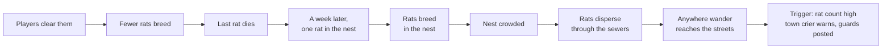

# The living world: spawns, wandering and world events

[Design summary](README.md) · Status: mob spawns (`Keep` and `Breed`, timed and `AfterDeath` resets, counting by origin, reseeding), wandering and crowding are built; item spawns, time-of-day spawns and world events are not. World events need combat.

The world populates itself and changes on its own. Every mob comes from a **spawn** in a zone file, which decides how often it resets and how many it wants. Mobs can **wander**, crowded rooms push them outward, and **world events** fire when the state of the world meets their conditions. There is one spawn model for everything, from a single dragon to a sewer full of breeding rats.

## Spawns and resets

A zone file lists its spawns. Each says **what** it spawns and **where**, **how often** it resets, and **how many** it wants after each reset.

```ron
spawns: {
    "gate_guards": (mob: "city_guard", room: "gate",
        every: Hours(1), refill: Keep(4), wander: Zone(secs: (30, 90))),
    "red_dragon": (mob: "old_red_dragon", room: "lair",
        every: AfterDeath(Days(30)), refill: Keep(1)),
    "sewer_rats": (mob: "sewer_rat", room: "sewers:nest",
        every: Minutes(20), refill: Breed(doubles_every: Hours(4), max: 200, reseed: Days(7)),
        wander: Anywhere(secs: (30, 120))),
    "angorim": (item: "angorim", room: "lair", every: Hours(6), refill: Keep(1)),
}
```

### When a spawn resets

| `every` | Resets |
| --- | --- |
| `Minutes(n)`, `Hours(n)`, `Days(n)` | On a fixed schedule, in real time |
| `AfterDeath(...)` | Once, that long after its last mob dies or its item is taken. The dragon returns 30 days after it is killed; a boss with guards returns only once all of them are dead |

### How many it wants

On each reset, a spawn counts its living mobs, works out how many it wants, and spawns the difference.

| `refill` | Wants after a reset |
| --- | --- |
| `Keep(n)` | `n`: replaces whatever died |
| `Breed(doubles_every, max, reseed, start)` | The current count grown by however much is due since the last reset, at least one more while any survive, never more than `max`. `reseed` is optional; `start` (default 1) is how many there are the first time the world runs |

**Breeding speed is set per spawn,** as how long the group takes to double. That's independent of `every`, which only sets how often new mobs appear:

| Spawn | Doubles every | Max | Reseed |
| --- | --- | --- | --- |
| Sewer rats | 4 hours | 200 | 7 days |
| Meadow rabbits | 8 hours | 60 | 2 days |
| Forest wolves | 5 days | 12 | 30 days |
| Cave trolls | 30 days | 4 | none |

Growth slows as a spawn nears `max`, so a nearly full nest fills in gradually rather than jumping to the cap.

**Last one standing.** When a breeding spawn's last mob dies, breeding stops, and the `reseed` timer starts. When it ends, a single new mob appears at the spawn and breeding resumes. Clearing out the sewer rats buys the city a week of peace, then one rat appears in the nest and it starts again. Without `reseed`, a breeding spawn that's wiped out stays gone (until a builder uses `spawn reset`).

**The population survives restarts.** A breeding spawn's count is saved whenever it changes (`spawn_counts`), so after a restart the same number come back, all at the spawn, and crowding spreads them out again within a minute. The reseed timer is saved too.

### Counting by origin

Every mob a spawn creates carries a tag naming its spawn, `SpawnedBy("sewer_rats")`. A reset counts tagged mobs **anywhere in the world**, not just in the spawn room.

- **Wanderers still count.** A guard patrolling the market counts toward the gate's spawn, so an empty gate doesn't produce extra guards.
- **No spawn farming.** Luring mobs away from their spawn point doesn't make it refill.
- **Triggers can count a spawn** the same way, for world events (`Count("sewer_rats", ">=", 150)`).

### Items

Item spawns use the same model. A spawned item belongs to its spawn until a player touches it; from then on it is a [real item](items.md#what-survives-a-restart) and no longer counts, so the next reset spawns a fresh one. [Unique items](items.md#unique-items) are the exception: their spawn checks for a real copy anywhere and never spawns a second. Fixed [containers](items.md#containers) such as chests belong to their spawn, which refills their contents on each reset.

## Wandering

Each spawn says how far its mobs may roam and how often they move.

| `wander` | Moves |
| --- | --- |
| `Never` (the default) | Stays in its spawn room |
| `Rooms(rooms: [...], secs: (min, max))` | Among the listed rooms, like a dog in the market |
| `Zone(secs: (min, max))` | Anywhere in its zone, like a city guard |
| `Anywhere(secs: (min, max))` | Anywhere, including other zones |

- **Each mob moves on its own random interval,** `min` to `max` seconds, so a room's goblins don't all move in the same tick. Each move picks a random open exit it's allowed to take, rolled through [`Dice`](attributes.md#the-dice-service). Mobs don't open doors yet.
- **Rooms can refuse wanderers** with a `no_wander` flag: temples, shops, players' homes.
- **A puppeted mob doesn't wander.** While a GM or admin [puppets](architecture.md#game-masters-and-puppeting) it, it only moves when they move it.
- **Wanderers move like players.** Rooms see "A stray dog arrives from the west." and "A city guard leaves north.", from the same `Left` and `Entered` [game events](architecture.md#game-events) players' moves write, so triggers and passive skills will see mob movement too.

## Mob templates

Mobs are templates in a zone's `mobs`, like items:

```ron
mobs: {
    "sewer_rat": (
        name: "a sewer rat",
        keywords: ["sewer", "rat"],                                   // default: the words of the name
        here: "A sewer rat scurries along the edge of the channel.",   // default: "A sewer rat is here."
        description: "A fat, filthy rat as long as your forearm...",  // what `look rat` shows
    ),
},
```

Rooms show each mob's `here` line, with repeats counted (`(x8)`), and `look <direction>` shows who's there. What a mob can *do* (attributes, skills, behaviour) arrives with combat.

## Building mobs and spawns

| Command | Does |
| --- | --- |
| `mob` / `mob <id>` | List this zone's mob templates, or show one |
| `mob new <id> <name>` | Create a template |
| `mob <name\|here\|desc\|keywords> <id> <value>` | Edit one (`mob here <id> none` restores the plain line) |
| `spawn` / `spawn <id>` | List this zone's spawns with how many are alive, or show one |
| `spawn new <id> <mob> [<count>]` | Add a spawn in this room: keeps `count` (default 1), resets every 10 minutes, doesn't wander |
| `spawn count <id> <n>` | Keep `n` (a breeding spawn becomes a keeping one) |
| `spawn breed <id> <doubling> <max> [<reseed>]` | Breed: `spawn breed sewer_rats 4h 200 7d` |
| `spawn crowd <id> <n\|none>` | How many of its mobs a room holds before they push outward |
| `spawn reset <id>` | Reset it now, whatever its timers say: refill, grow, or bring back a wiped-out spawn |
| `spawn every <id> <10m\|2h\|1d\|death 30d>` | How often it resets. A new schedule starts at once |
| `spawn wander <id> never` / `zone <min> <max>` / `anywhere <min> <max>` / `rooms <min> <max> <room>...` | How far its mobs roam, and how often they move, in seconds |
| `spawn mob <id> <mob>` / `spawn room <id>` | Change what it spawns, or move it to this room |
| `spawn remove <id>` | Remove the spawn and its mobs |
| `summon <mob>` | Bring a mob here that belongs to no spawn, for testing |
| `purge [<mob>]` | Remove a mob here, or every mob here. Its spawn refills at its next reset |

Rooms can be flagged with `flag <indoors|no_wander> <on|off>`, or in the zone file. `no_wander` turns wanderers away; Riftwatch marks its shops, the shrine and the guild's quieter rooms. `indoors` hides the sky, so dawn and dusk pass unannounced; the sewers and the town's halls are indoors.

## Doors

Status: built, except hidden doors, keys and resets. Doors are open, close, lock, unlock and bash-able today.

Exits keep their short form, `"west": "square"`. A longer form adds a door, defined once in the zone and named by both sides, so opening it from one room opens it from the other:

```ron
doors: {
    "cellar_door": (name: "a heavy oak door", state: Locked,
        lock: Some((key: Some("cellar_key"), pick: Some(4), bash: Some(12)))),
    "trapdoor": (name: "a trapdoor"),                     // closed, no lock
    "bookcase": (name: "a bookcase", keywords: ["bookcase", "shelves"], hidden: true),
},
rooms: {
    "tavern": ( ..., exits: { "west": "square", "down": (to: "cellar", door: "cellar_door") } ),
    "cellar": ( ..., exits: { "up": (to: "tavern", door: "cellar_door") } ),
},
```

- **The lock is the shared [lock model](items.md#locks-and-keys):** open, closed or locked; keys, `pick` and `bash`. Doors are targeted by direction first (`open north` → "It's locked.") or by name (`open door`, `open trapdoor`).
- **Keywords** default to the words of the name without its article, so "a heavy oak door" answers to `heavy`, `oak` and `door`.
- **A trapdoor is just a door on an `up` or `down` exit.**
- **Doors between zones** use `zone:door` names on both sides.
- **A closed door blocks movement** for players and wandering mobs: `north` gives "The heavy oak door is closed." Mob templates can be allowed to open doors, such as a guard who carries the gate key.
- **Rooms show door state:** "Exits: west, down (closed)", and `look down` describes the door.
- **`bash` only forces a door open.** It isn't broken; it can be closed and locked again.
- **Doors reset with their zone,** back to their default state, so the cellar is locked again after the next reset (once resets exist). Door state isn't saved across restarts.

### Building doors

| Command | Does |
| --- | --- |
| `door <dir> <name>` | Add a closed door with no lock to that exit (and to the exit back, if there is one), or rename the door already there |
| `door <dir> lock` | Give it a lock (pick 5, bash 10, no key yet) that starts locked |
| `door <dir> nolock` | Remove its lock |
| `door <dir> open` / `closed` | Set whether it starts open or closed |
| `door <dir> remove` | Remove the door from both sides |
| `door <dir>` | Show the door: id, how it starts, its lock |

The door's id comes from its name (`a heavy oak door` → `heavy_oak_door`). Changing how a door starts takes effect at once, and `link` and `unlink` refuse to touch an exit with a door until it's removed.

### Hidden doors

A door with `hidden: true` isn't in a room's exits **for each character until that character finds it**. To someone who hasn't found it, the exit doesn't exist: "You can't go that way."

- **Finding** uses a `search` command, rolled through `Dice` against Intuition and a searching skill, or happens when a condition is met (`reveal_when: WorldFlag("lever_pulled")`).
- **Found doors are remembered per character,** as a [flag](skills.md#hidden-skills) on the character (`found_door:town:bookcase`), so they stay found across resets and restarts. Other players still have to find it themselves.

## Crowding

A spawn can set how many of its mobs one room holds comfortably (`crowd: 6`). Its mobs then stay put at their wander checks while their room holds that many or fewer. Past that, the extras move on, each toward the neighbouring room within its wander range that holds the fewest of its kind (a random one among equals). A spawn without `crowd` wanders as usual, moving at every check.

So the nest fills to its limit, then rats spill into the next rooms, which fill in turn, and the population pushes outward as it grows. They can only leave through open exits: the grates hold them in the sewers until someone opens one.

Crowding plus breeding is how a neglected sewer overruns the city, with no special rule:



## World state

The world keeps its own **flags** (`goblin_king_alive`, `city_quarantined`) and **counters** (`goblins_slain_this_week`), saved in a `world_state` table. Flags and counters are set by events, and read by triggers and by other systems' conditions.

World flags join the shared [condition language](skills.md#hidden-skills), so the world and the rest of the design build on each other: a hidden skill can require `WorldFlag("goblin_king_slain")`, and a trainer can appear only once `WorldFlag("city_cleared")` is set.

## World events

An event has a trigger and a list of actions. Triggers use the condition language, with new terms for the world:

| Condition | Met when |
| --- | --- |
| `Count(spawn, op, n)` | A spawn's living mobs compare to `n` |
| `WorldFlag(id)` | A world flag is set |
| `WorldCounter(id, op, n)` | A world counter compares to `n` |
| `Event(game_event)` | A [game event](architecture.md#game-events) happens, such as `Died("goblin_king")` |
| `TimeOfDay(...)` | The game clock is in a range (with the time system) |
| `All`, `Any`, `Not` | Combinations, as everywhere |

Actions are a small fixed set:

| Action | Does |
| --- | --- |
| `Spawn(mob or item, room)` | Creates something outside the normal spawns, such as a boss |
| `SetWorldFlag(id)`, `ClearWorldFlag(id)` | Change world state |
| `AddToCounter(id, n)` | Change a counter |
| `Buff(spawn, effect)`, `RemoveBuff(spawn, effect)` | Strengthen or weaken every mob from a spawn |
| `Cull(spawn, fraction)` | Kill off part of a spawn's mobs |
| `Announce(scope, text)` | Tell a room, a zone, or everyone |

```ron
events: {
    "goblin_king_rises": (
        when: All([Count("goblin_camp", ">=", 80), Not(WorldFlag("goblin_king_alive"))]),
        then: [
            Spawn(mob: "goblin_king", room: "goblin_caves:throne"),
            SetWorldFlag("goblin_king_alive"),
            Buff("goblin_camp", "kings_command"),
            Announce(Zone("goblin_caves"), "War drums echo through the caves..."),
            Announce(Zone("town"), "Travellers speak of a goblin king rising in the hills."),
        ],
    ),
    "goblin_king_falls": (
        when: Event(Died("goblin_king")),
        then: [
            ClearWorldFlag("goblin_king_alive"),
            RemoveBuff("goblin_camp", "kings_command"),
            Cull("goblin_camp", 0.5),
            Announce(Everyone, "The goblin king is dead!"),
        ],
    ),
}
```

- **Events are data.** New stories are new events in zone files, not new code.
- **Re-checked only on change.** A trigger is evaluated when something it depends on changes (a spawn's count, a flag, a counter, a game event), never on a timer.
- **The goblin king is just a spawned mob** with a buff on its kin. Killing it is an ordinary death that another event reacts to.

## What survives a restart

| Thing | After a restart |
| --- | --- |
| Mobs | Respawned fresh at their spawns, except breeding spawns, which return to their saved count |
| Spawn timers | Saved (`spawn_state`), so the dragon doesn't return early and the week-long reseed keeps counting |
| World flags and counters | Saved (`world_state`) |
| Items | [Real items](items.md#what-survives-a-restart) are restored; untouched spawned items are not |
| Doors and locks | Back to their default state, like a reset |
| Hidden doors a character has found | Saved per character |

## Build order

1. **With items and mobs:** spawns with `Keep`, `every` timers, counting by origin, `spawn_state`, and wandering. *Built for mobs; item spawns still to do.*
2. **With the time system:** `Breed` and `reseed`, crowding, `TimeOfDay`. *Built, except `TimeOfDay` spawns.*
3. **With combat:** world flags, counters and events, starting with `Count`, `Event(Died(...))` and the actions above.

## Open questions

- [ ] **Can players see the state of the world,** or only its effects? A town crier or a guard captain could report "The rat problem is getting worse."
- [ ] **Do events fire once, or every time** their trigger becomes true again? Proposed: every time, with an optional `once: true` for one-off history.
- [ ] **Should spawns expand on their own,** with goblins founding new camps in new zones, or only spread by crowding and wandering?
- [ ] **Default crowd limit** when a spawn doesn't set one: none, or a general limit per room to stop pile-ups?
